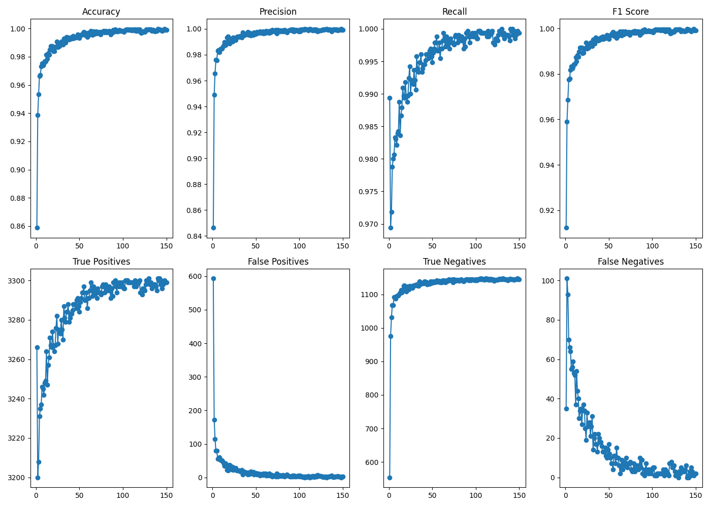

# Pneumonia Recognition

A PyTorch deep learning project that detects pneumonia in chest X-ray images using a fine-tuned DenseNet201 model.

## Overview

This project classifies chest X-rays as either:

- `NORMAL` / `0`
- `PNEUMONIA` / `1`

The model uses DenseNet201 transfer learning. Most pretrained layers remain frozen, while the final DenseNet block, final normalization layer, and classifier are fine-tuned for the pneumonia recognition task.

## Features

- DenseNet201 transfer learning
- Partial fine-tuning of `denseblock4`, `norm5`, and the classifier
- Class-weighted loss to reduce the effect of class imbalance
- CUDA, MPS, or CPU device selection
- Training, validation, and testing pipelines
- Threshold tuning on the validation set
- Accuracy, precision, recall, F1, ROC-AUC, and confusion matrix reporting
- ROC curve visualization

## Dataset

Dataset: Chest X-Ray Images (Pneumonia)

Classes:

- `NORMAL`
- `PNEUMONIA`

Images are resized to `224x224`, converted to three-channel grayscale, normalized with ImageNet statistics, and lightly augmented during training.

Training augmentations include:

- small rotations
- slight translation and scaling
- mild brightness and contrast jitter

**Chest X-Ray Images (Pneumonia)**  
Sourced from [Kaggle](https://www.kaggle.com/datasets/paultimothymooney/chest-xray-pneumonia), originally published by Kermany et al.

> Kermany, D., Zhang, K., & Goldbaum, M. (2018). Identifying Medical Diagnoses and Treatable Diseases by Image-Based Deep Learning. *Cell*, 172(5), 1122-1131. https://doi.org/10.1016/j.cell.2018.02.010

## Installation

```bash
git clone https://github.com/cfr081709/pneumonia-recognition.git
cd pneumonia-recognition
python3 -m venv venv
. venv/bin/activate
pip install --upgrade pip setuptools wheel
pip install -r requirements.txt
```

The web demo also requires Node.js and npm. From the repository root, install its Node dependencies:

```bash
npm install
```

## Web App (Frontend and Backend)

The frontend and prediction backend are served together by the Node.js server; there is no separate frontend development server to start. The backend launches the Python model script when an image is submitted.

Start it from the repository root in a terminal:

```bash
. venv/bin/activate
npm start
```

Then open [http://localhost:3000](http://localhost:3000) in a browser, select a chest X-ray image, and submit it. Leave the terminal running while using the app; press `Ctrl+C` there to stop the server. To use a different port, set `PORT` before starting, for example `PORT=3001 npm start`, and visit that port instead.

The server defaults to the Python interpreter at `venv/bin/python` when that file exists, otherwise it runs `python` from `PATH`. If the fallback command does not point to the environment with the project requirements installed, set `PYTHON_CMD` to that environment's Python executable before starting the server. For example:

```bash
PYTHON_CMD=/path/to/venv/bin/python npm start
```

Predictions use `models/best_auc/model.pth` by default. If that checkpoint is missing, train a model first or set `MODEL_PATH` to a compatible checkpoint file or model directory. The first prediction can take longer while Python and the model load. The `/predict` endpoint accepts JSON containing an `image_base64` field and returns the predicted label and confidence; the browser app calls this endpoint automatically.

This is a local research/demo application, not a medical device. Do not use its output for diagnosis or treatment decisions, and do not expose the server to the public internet: the upload endpoint has no authentication or upload-size limit.

## Training

```bash
python src/train.py
```

Training uses class weights computed from the training dataset. This helps compensate for the dataset imbalance between normal and pneumonia X-rays.

The model fine-tunes only the last part of DenseNet201:

- `features.denseblock4` at a low learning rate
- `features.norm5` at a low learning rate
- `classifier` at a higher learning rate

Training results are saved to:

```text
results/train_results/train_results.csv
results/train_results/train_plots.png
```

Training plot:



## Evaluation

```bash
python src/eval.py
```

Evaluation runs the model on the validation set and tunes the pneumonia decision threshold. By default the evaluation now prioritizes precision (favouring fewer false positives) when selecting the decision threshold — this biases the system to make more conservative 'pneumonia' predictions.

The evaluation script searches thresholds across a wide range and selects the threshold that maximizes validation precision (with F1 used as a tiebreaker). The selected threshold and its validation metrics are saved for use during testing.

Evaluation results are saved to:

```text
results/eval_results/evaluation_results.csv
results/eval_results/evaluation_plots.png
```

The selected threshold is saved to:

```text
models/best_auc/threshold.txt
models/best_auc/threshold_metrics.csv
```

## Testing

```bash
. venv/bin/activate
python src/test.py
```

Testing loads the saved threshold from evaluation when available. If no tuned threshold exists, it falls back to a higher default of `0.7` to reduce false positives (this favors precision over recall).

Test results include the same metrics used during training to aid comparison:

- Accuracy
- Precision
- Recall
- F1 score
- ROC-AUC
- Score (mean of Accuracy, Precision, Recall, F1, ROC-AUC)
- TP, FP, TN, FN counts

Results are saved to:

```text
results/test_results/test_results.csv
```

## Full Pipeline

```bash
. venv/bin/activate
python src/main.py
```

The full pipeline runs training, evaluation, and testing in sequence.

## Project Structure

```text
pneumonia_recognition/
  data/
    train/
    val/
    test/
  models/
    best_auc/
  results/
    train_results/
    eval_results/
    test_results/
  src/
  train.py
  eval.py
  test.py
  main.py
  model.py
  data.py
```

## Technologies

- Python
- PyTorch
- Torchvision
- Pandas
- Matplotlib
- Scikit-learn
- Node.js HTTP server for the web demo
